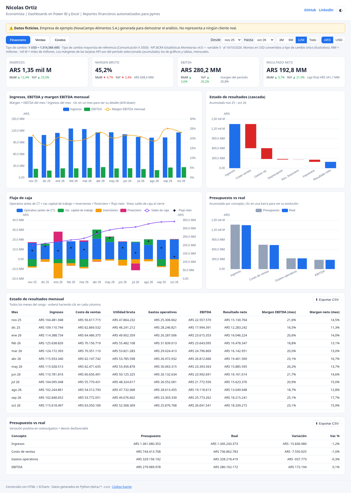
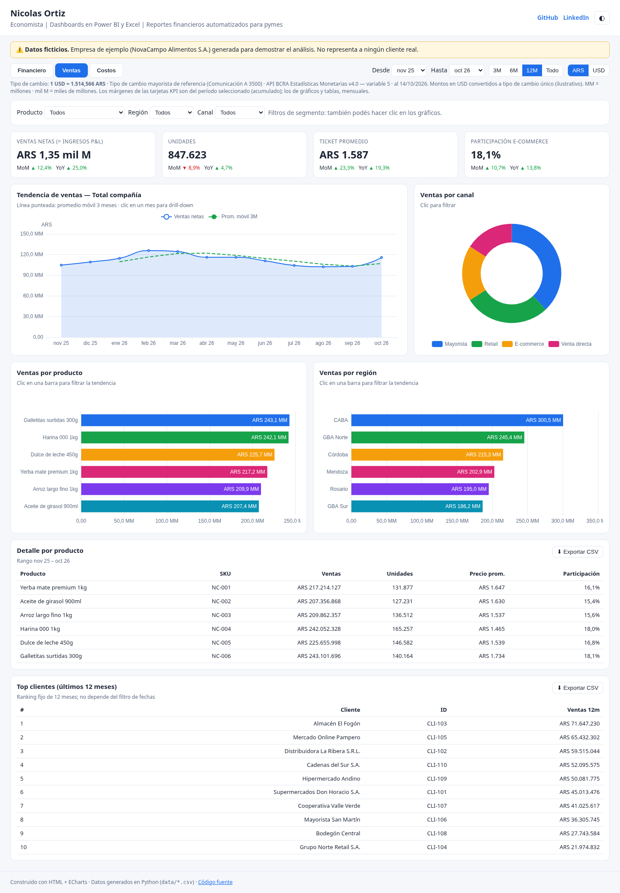
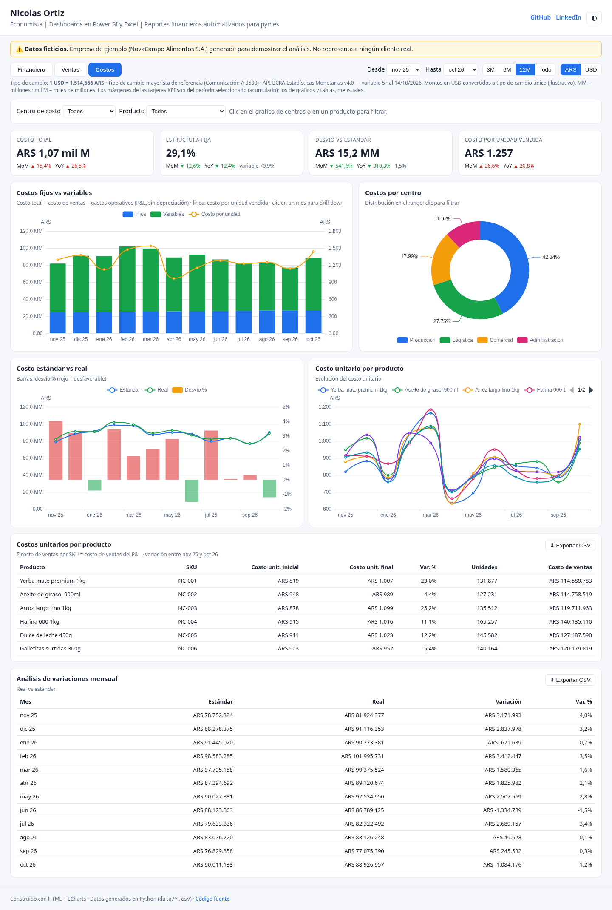
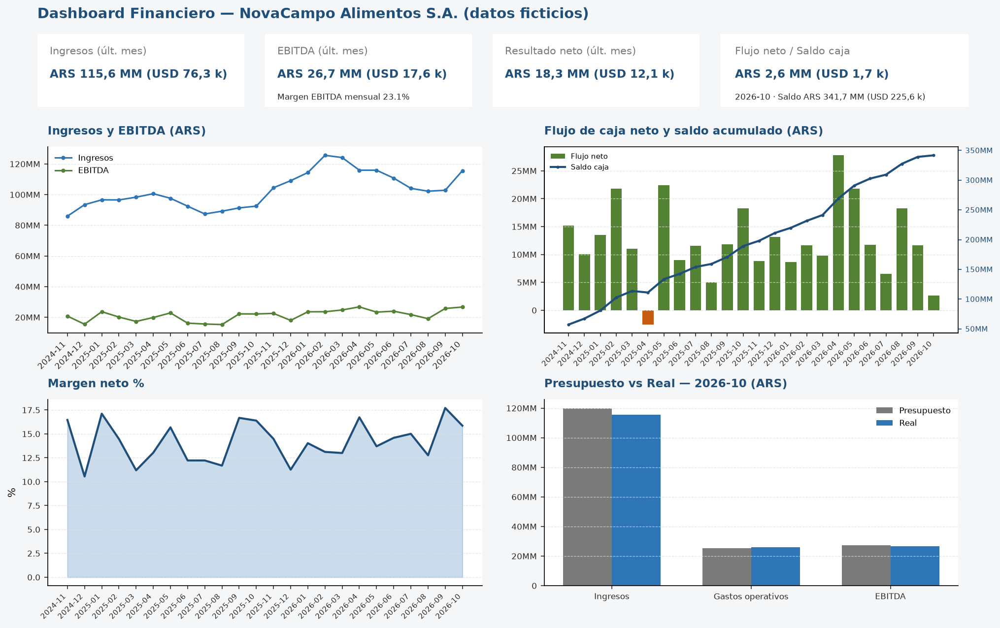
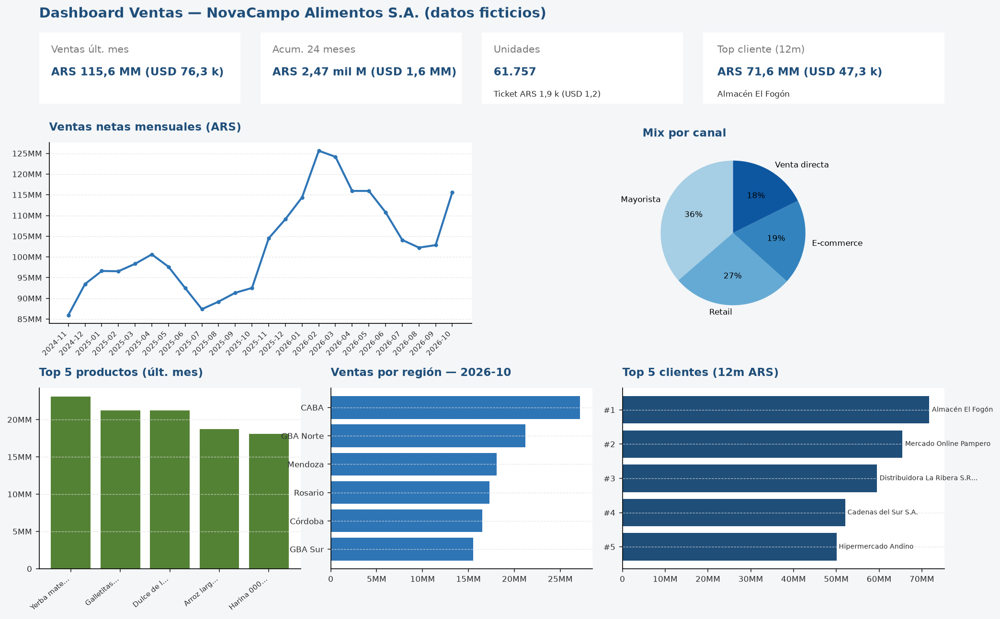
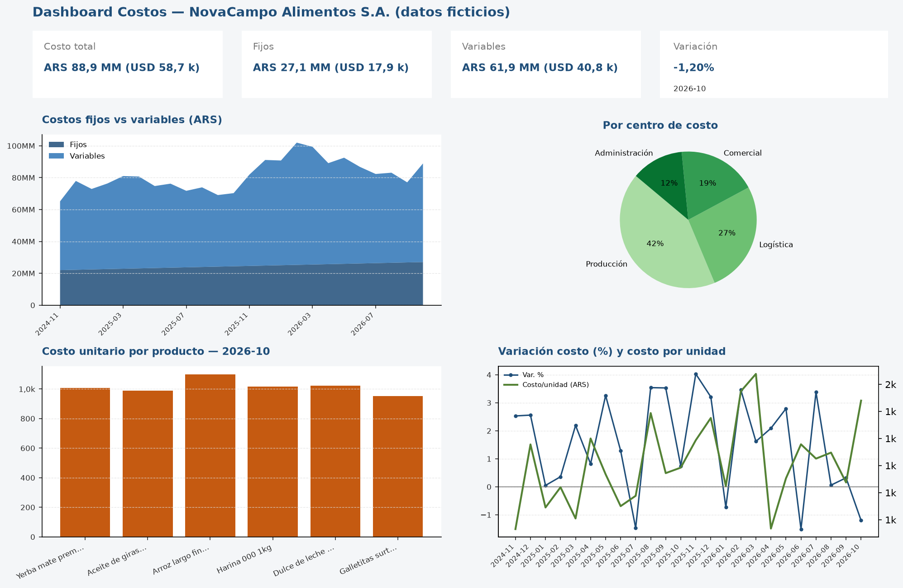

# Economista | Dashboards en Power BI y Excel | Reportes financieros automatizados para pymes

Portfolio de **Business Intelligence** con tres tableros de ejemplo para una pyme argentina ficticia (**NovaCampo Alimentos S.A.**). El objetivo es mostrar automatización de reportes financieros y comerciales en **Excel** y visualizaciones listas para **Power BI**, a partir de los mismos archivos CSV.

> **Aviso importante:** todos los nombres de empresa, clientes, montos y series temporales son **enteramente ficticios** y se generan con un generador aleatorio con semilla fija (`SEED=42`). No representan operaciones reales ni datos de terceros.

## 🌐 Dashboard web interactivo

**Demo online:** https://nicolasortizzz.github.io/portfolio-dashboards-bi/

App web estática (HTML + [ECharts](https://echarts.apache.org/)) con los tres tableros sobre los mismos datos ficticios de `data/*.csv`:

- **Financiero:** estado de resultados en cascada, ingresos/EBITDA/margen, flujo de caja con saldo, presupuesto vs real.
- **Ventas:** tendencia con promedio móvil, ventas por producto, región y canal, top clientes.
- **Costos:** fijos vs variables, costos por centro, estándar vs real (desvíos), costo unitario por producto.

Interactividad: filtro de rango de meses (3M/6M/12M/Todo), filtros por producto, región, canal y centro de costo, **toggle ARS/USD** (tipo de cambio BCRA de `config/exchange_rate.json`, con fecha y fuente), drill-down con clic en gráficos, KPIs con variación MoM/YoY, tablas ordenables con **exportación a CSV**, modo claro/oscuro y diseño responsive.

| Financiero | Ventas | Costos |
|---|---|---|
|  |  |  |

Correr localmente:

```bash
node scripts/build_web.mjs      # CSV -> site/data/data.json
npx http-server site            # o: python3 -m http.server -d site
```

Publicado en GitHub Pages (rama `gh-pages`, contenido de `site/`). También listo para Vercel vía `vercel.json` (build `node scripts/build_web.mjs`, output `site/`).

## Tipo de cambio ARS/USD

Las columnas en dólares se calculan con el tipo de cambio documentado en `config/exchange_rate.json`:

| Campo | Valor |
| --- | --- |
| **Cotización** | 1514,5655 ARS por USD |
| **Fecha** | 2026-10-14 |
| **Tipo** | Tipo de cambio mayorista de referencia (Comunicación A 3500) |
| **Fuente** | API BCRA Estadísticas Monetarias v4.0 — variable 5 ([bcra.gob.ar](https://www.bcra.gob.ar/)) |

Si la API del BCRA no está disponible al ejecutar `generate_data.py`, se usa una tasa de respaldo fija documentada en el script y en el JSON (`fallback: true`).

Conversión y formato reutilizable: módulo `scripts/fx.py` (`ars_to_usd`, `usd_to_ars`, `load_exchange_config`, `format_kpi_ars_usd`, formatos Excel ARS/USD).

## Cómo regenerar todo

```bash
python3 -m venv .venv
source .venv/bin/activate   # Windows: .venv\Scripts\activate
pip install -r requirements.txt
python run_all.py
```

O con Make:

```bash
make all
# o paso a paso: make data excel images
```

**Salidas:**

- `data/*.csv` — 24 meses de series ficticias
- `excel/dashboard_*.xlsx` — libros con KPIs, tablas formateadas y gráficos nativos de Excel
- `images/dashboard_*.png` — vistas estilo dashboard (matplotlib)

Un archivo **Power BI (.pbix)** puede armarse importando los CSV de `data/` y replicando las mismas métricas y relaciones por mes, producto, canal y centro de costo.

## Stack

- **Python 3.11+** — pandas, numpy, requests, openpyxl, matplotlib
- **Excel** — tablas con formatos ARS/USD, paneles congelados y gráficos nativos
- **Power BI** — mismo modelo de datos desde CSV (no incluido en el repo; flujo documentado arriba)

---

### Consistencia de datos

Todos los tableros salen de la misma fuente: ventas por producto, canal y región suman exactamente los ingresos del P&L cada mes; el costo total (y su apertura por centro, fijo/variable y estándar vs. real) es igual a costo de ventas + gastos operativos del P&L. `scripts/check_reconciliation.py` lo verifica mes a mes y falla si algo no cierra (se ejecuta en `run_all.py` / `make check`).

**Convenciones:** MM = millones, mil M = miles de millones; toda cifra indica ARS o USD. **Márgenes:** en tablas, gráficos e imágenes son **mensuales** (resultado del mes / ingresos del mes); en las tarjetas KPI de la web son del **período seleccionado** (acumulado del rango). No se usan márgenes LTM.

## 1. Dashboard Financiero

Estado de resultados (P&L), flujo de caja y presupuesto vs. real.



**KPIs destacados (último mes, 2026-10 — ARS con equivalente USD):**

| Métrica | Valor |
| --- | --- |
| Ingresos | ARS 115,6 MM (USD 76,3 k) |
| EBITDA (margen EBITDA mensual 23,1 %) | ARS 26,7 MM (USD 17,6 k) |
| Resultado neto (margen neto mensual 15.9 %) | ARS 18,3 MM (USD 12,1 k) |
| Flujo neto del mes | ARS 2,6 MM (USD 1,7 k) |
| Saldo de caja acumulado | ARS 341,7 MM (USD 225,6 k) |

El flujo de caja se presenta sin doble conteo: **flujo operativo (antes de capital de trabajo) = resultado neto + depreciación**; **flujo neto = operativo + variación de capital de trabajo + inversiones + financiamiento**. El resultado neto suma el resultado financiero con su signo (negativo = costo financiero). **Presupuesto vs. real** por concepto (ingresos, costos, gastos, EBITDA).

Archivos: `data/financiero_*.csv` · Excel: `excel/dashboard_financiero.xlsx`

---

## 2. Dashboard Ventas

Ventas por mes, producto, canal, región y ranking de clientes (nombres ficticios).



**KPIs destacados (2026-10):**

| Métrica | Valor |
| --- | --- |
| Ventas del mes (= ingresos del P&L) | ARS 115,6 MM (USD 76,3 k) |
| Acumulado 24 meses | ARS 2,47 mil M (USD 1,6 MM) |
| Unidades / ticket | 61.757 u. · ticket ARS 1,9 k (USD 1,2) |
| Top cliente 12m | *Almacén El Fogón* — ARS 71,6 MM (USD 47,3 k) |

**Mix por canal** (mayorista ~36 %, retail, e-commerce, venta directa), **ventas por región** y ranking de clientes ficticios.

Archivos: `data/ventas_*.csv` · Excel: `excel/dashboard_ventas.xlsx`

---

## 3. Dashboard Costos

Costos fijos y variables, por centro de costo, costo unitario y variaciones vs. estándar.



**KPIs destacados (2026-10):**

| Métrica | Valor |
| --- | --- |
| Costo total (= costo de ventas + gastos operativos del P&L) | ARS 88,9 MM (USD 58,7 k) |
| Fijos / variables | ARS 27,1 MM (USD 17,9 k) · ARS 61,9 MM (USD 40,8 k) |
| Variación vs, estándar | -1,20 % |

**Centros de costo** (producción ~42 %), **costo unitario** por SKU (Σ costo de ventas por SKU = costo de ventas del P&L) y evolución del costo por unidad vendida.

Archivos: `data/costos_*.csv` · Excel: `excel/dashboard_costos.xlsx`

---

## Estructura del repositorio

```
├── config/exchange_rate.json
├── data/
├── excel/
├── images/
├── scripts/
│   ├── fx.py
│   ├── generate_data.py
│   ├── build_excel.py
│   └── render_dashboards.py
├── run_all.py
├── Makefile
└── requirements.txt
```

## Contacto

- GitHub: [nicolasortizzz](https://github.com/nicolasortizzz)
- LinkedIn: [nicolas-ortizzz](https://www.linkedin.com/in/nicolas-ortizzz/)
